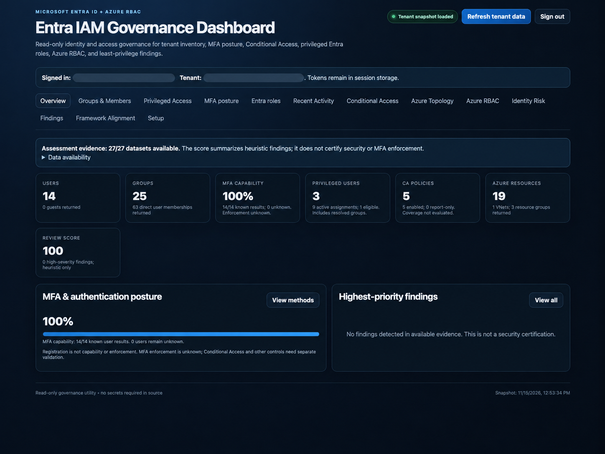
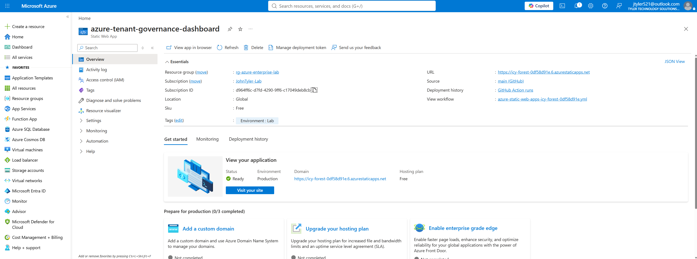

# Entra IAM Governance Dashboard

A read-only, multi-tenant JavaScript/Vite application for Microsoft Entra identity governance, privileged access visibility, Azure RBAC assessment, and security-framework evidence mapping. The dashboard lets authorized users sign in with Microsoft Entra ID, queries Microsoft Graph and Azure Resource Manager with delegated access, and produces an interactive governance snapshot focused on identity posture, MFA, privileged access, Azure RBAC, least privilege, recent activity, and Azure resource topology.

## Live deployment

**Production Azure Static Web App:** https://icy-forest-0df58d91e.6.azurestaticapps.net

The production deployment uses a shared multi-tenant Microsoft Entra application registration. Users from other Microsoft Entra organizations can authenticate with their own organizational accounts, subject to their tenant's consent policies and their own permissions.

The app does **not** grant access to another tenant or Azure subscription by itself. Microsoft Graph data is limited by the signed-in user's delegated permissions and Entra role context, while Azure subscription analysis requires the signed-in user to already have appropriate Azure RBAC access in that subscription.

### Live tenant dashboard



### Azure Static Web App deployment



## Current capabilities

The application currently exposes 13 navigation areas: **Overview, Groups & Members, Privileged Access, MFA posture, Entra roles, Recent Activity, Conditional Access, Azure Topology, Azure RBAC, Identity Risk, Findings, Framework Alignment, and Setup.** The on-screen product name is **Entra IAM Governance Dashboard**; the GitHub repository retains its original name.

- **Tenant overview:** Inventories Microsoft Entra users, guests, groups, and service principals, with summary metrics, highest-priority findings, Conditional Access policy counts, Azure resources, and a coverage-aware review score.
- **Groups & Members:** Searchable, expandable group inventory with direct user members, account state, group types, and resolved privileged Entra roles. Group owners are collected to support ownership checks.
- **MFA posture:** Per-user registration methods and reported MFA registration/capability, plus authentication-method policy inventory and targeting. Registered or capable does **not** mean MFA is enforced; enforcement is displayed as Unknown.
- **Entra roles:** Active directory role membership inventory and searchable principal/role views.
- **Recent Activity:** Directory audit events, sign-in events from the last seven days (up to 25 returned by the current query), and graceful handling of license, permission, or throttling limitations. Audit logs are not a substitute for sign-in telemetry.
- **Privileged Access:** Active and PIM-eligible Entra directory assignments, access paths (direct or group-inherited), role/scope, and dates where exposed; higher-impact roles are presented first.
- **Azure RBAC:** Searchable role assignments and definitions, including inherited/effective user access paths where resolvable; role tiers prioritize Owner, User Access Administrator, Role Based Access Control Administrator, and Contributor, with broader scopes ranked first within tiers. Ranking is triage guidance, not a complete effective-permissions calculation.
- Provides a live **Azure Topology** view for subscription resources, including VNet → subnet → NIC → VM relationships with Public IP and NSG context.
- **Identity Risk:** Evidence-backed, prioritized advisory reviews of active Global Administrator / Privileged Role Administrator assignments and broad-scope Azure privileged roles. Emergency-named accounts are flagged for validation rather than automatic removal.
- **Conditional Access:** Read-only inventory of policy state, assignments, targeting, grant controls, and session controls when readable. This is not a policy simulation or proof of enforced coverage.
- **Framework Alignment:** Evidence crosswalk to **NIST CSF 2.0**, **ISO/IEC 27001:2022 Annex A**, and **CIS Controls v8**, including observed, unknown, and unassessed controls and JSON export. The app does not certify compliance.
- **Governance Findings:** Heuristic checks for broad Azure assignments such as Owner, Contributor, and User Access Administrator.
- Flags privileged Entra identities that are not reported as MFA-capable.
- Flags guest identities with broad Azure access.
- Produces a lightweight governance review score.
- Exports findings as **JSON or CSV**, with snapshot/coverage context; the framework crosswalk can also be exported as JSON.

The application is intentionally **read-only**. It does not perform Microsoft Graph or Azure Resource Manager write operations.

## How to interpret the assessment

This is an evidence-assisted **review tool**, not a live policy enforcement system, vulnerability scanner, compliance attestation, or access-remediation engine. A flagged role is a candidate for human review, not proof that access is inappropriate. Missing Graph/ARM data is visibly partial, unavailable, or skipped and must not be interpreted as a pass. The numeric governance score is withheld unless all tracked sources are available.

The framework crosswalk maps selected collected signals to relevant control families; for example, access-review completion, endpoint hardening, and actual Conditional Access enforcement require independent evidence not collected here. MFA registration, reported capability, and enforcement are separate concepts. The dashboard never changes tenant configuration.

## Multi-tenant model

The production application is designed so users from other Microsoft Entra organizations can authenticate without creating a separate app registration for each tenant.

At a high level:

1. The browser redirects the user to Microsoft Entra ID through MSAL.js.
2. The user authenticates with an organizational Microsoft account.
3. Microsoft Entra evaluates the tenant's consent and access policies.
4. The browser receives delegated access tokens for the approved Microsoft Graph and Azure Resource Manager scopes.
5. The dashboard queries only data the signed-in identity is already authorized to read.

Authentication does **not** equal authorization. Signing in successfully does not automatically provide access to privileged Entra data or an Azure subscription.

## External-tenant onboarding

For a user in another Microsoft Entra organization:

1. Open the production dashboard.
2. Sign in with the organization's Microsoft Entra account.
3. Complete user or administrator consent if required by that tenant's consent policy.
4. Enter the Azure Subscription ID to analyze Azure resources.
5. Ensure the signed-in account already has the required Microsoft Entra permissions and Azure RBAC access described below.

No client secret is required from the user, and users do not need to create their own application registration for the hosted multi-tenant version.

## Architecture

```text
Browser SPA
  |
  |-- MSAL.js / OAuth 2.0 Authorization Code + PKCE
  |      |
  |      +-- Microsoft Entra ID (multi-tenant authentication)
  |
  |-- Microsoft Graph
  |      |-- Users / Groups / Service Principals
  |      |-- Group → direct user membership
  |      |-- Directory Roles
  |      |-- Role Assignment Schedule Instances
  |      |-- Role Eligibility Schedule Instances
  |      |-- Authentication Methods Registration Report
  |      |-- Directory Audit Logs
  |      |-- Conditional Access Policy / Authentication Methods Policy
  |      +-- Sign-in Logs when available
  |
  +-- Azure Resource Manager
         |-- Role Assignments
         |-- Role Definitions
         |-- Resource Groups
         |-- Virtual Networks / Subnets
         |-- Network Interfaces
         |-- Public IPs / NSGs
         +-- Virtual Machines
```

Framework alignment and identity-risk review are computed client-side from the collected evidence. There is no application backend. Access tokens are handled by MSAL in browser session storage. Tenant data remains in browser memory unless the user explicitly exports a findings file.

## Permission model

The dashboard depends on two separate authorization layers.

### 1. Microsoft Entra ID / Microsoft Graph

The shared application requests delegated Microsoft Graph access for the governance data it reads. Depending on the feature and tenant policy, administrator consent and an appropriate Microsoft Entra directory role may be required.

Relevant delegated permissions include:

- `User.Read`
- `Directory.Read.All`
- `RoleManagement.Read.Directory`
- `AuditLog.Read.All`
- `UserAuthenticationMethod.Read.All` for the optional detailed method inventory
- `Policy.Read.AuthenticationMethod` for authentication-method policy
- `Policy.Read.All` for Conditional Access policy inventory

Permissions are acquired separately for each feature. Denied consent for an optional
feature does not prevent directory or Azure inventory. No write permission has been
added; the application still uses GET operations only. ARM `user_impersonation` is
bounded by the signed-in user's Azure roles, so use a reader identity.

Examples:

- Authentication Methods reporting depends on `AuditLog.Read.All` plus the signed-in user's effective Entra permissions.
- Sign-in logs depend on Graph permissions, the signed-in user's Entra permissions, and licensing that exposes sign-in telemetry.
- Privileged-role visibility depends on the role-management permissions exposed to the signed-in identity.

### 2. Azure Resource Manager / Azure RBAC

The dashboard also requests Azure Service Management delegated access:

```text
https://management.azure.com/user_impersonation
```

That scope allows the application to act on behalf of the signed-in user. It does **not** grant Azure subscription access by itself.

For Azure subscription analysis, the signed-in user must already have RBAC access to the Subscription ID entered in the dashboard.

Recommended read-only access:

- **Reader** at the subscription scope is the baseline for resource inventory used by the Azure Topology view.
- **Role Based Access Control Reader** at the subscription scope is recommended when the dashboard needs to reliably enumerate Azure role assignments and role definitions.

The dashboard does **not** require Owner, Contributor, or User Access Administrator simply to function. Assigning broad roles only for this dashboard would violate least-privilege principles.

Knowing a Subscription ID does not provide access to that subscription.

## Security boundaries

- The app is read-only by design.
- It does not create, modify, or delete Microsoft Entra identities, groups, roles, policies, or Azure resources.
- It does not bypass tenant Conditional Access, consent requirements, licensing restrictions, Entra directory roles, or Azure RBAC.
- A user can only retrieve data Microsoft Entra ID, Microsoft Graph, and Azure Resource Manager authorize for that identity.
- No client secret is embedded in the browser application.
- The shared Entra application/client ID is a public application identifier, not a credential.
- Access tokens are not committed to GitHub.
- MSAL authentication cache uses `sessionStorage`.
- Only non-secret configuration identifiers are persisted in browser storage.
- Findings exports are generated locally in the browser.
- The governance score is a heuristic and is not a security certification, audit opinion, or compliance attestation.

## Local development

```bash
npm ci
npm run dev
```

Open the local Vite URL, normally:

```text
http://localhost:5173
```

Local development may require the appropriate Entra client configuration and redirect URI for the environment being used.

Use Node 22.12 or later. Copy `.env.example` to `.env` and replace its placeholder
with your public SPA client ID. The source entry point is `src/main.js`; there is no
generated JavaScript entry point or source-rewriting build step.

Run automated local checks with:

```bash
npm run validate
```

This runs the Node regression tests and Vite production build. Test fixtures use
synthetic accounts and mock API responses; they do not read or change a live tenant.

## Assessment accuracy and limitations

- A numeric review score is withheld unless all tracked evidence sources are available.
  Unavailable licensing/permissions, incomplete collections and skipped Azure inventory
  produce `Incomplete` in the UI and `null` in JSON. This includes missing PIM visibility.
- Groups & Members remains a direct-user view. Privileged user counts, role views and
  findings also include resolved group-based access, with the source group shown.
  Azure nested membership follows Graph's transitive-members result. Entra role-assignable
  groups do not support nesting, and latent PIM-for-Groups membership is not evaluated.
- Successful Azure datasets remain visible if another Azure request fails. Failed or
  hidden membership is labelled unknown rather than treated as an empty group.
- MFA registration, reported capability and enforcement are distinct. Enforcement stays
  **Unknown**; registered methods and enabled policies do not prove a sign-in requirement.
- Missing successful-sign-in timestamps do not prove inactivity. Expired/unusable
  Temporary Access Passes do not count as usable method registrations.
- JSON exports include coverage and snapshot timestamps. CSV retains the four finding
  columns and adds assessment metadata columns and an `assessment` record, even when
  no findings exist. Directory values are escaped against spreadsheet formulas.
- Read-only requests do not make an ARM token intrinsically read-only. Use an identity
  with the least Azure access needed. The dashboard is not a complete custom-role,
  deny-assignment or Conditional Access evaluation engine.

See [architecture and trust boundaries](docs/ARCHITECTURE.md) for the coverage model,
request/session isolation and remaining limitations.

## Production deployment

The project is deployed to Azure Static Web Apps from this GitHub repository through GitHub Actions.

Current deployment model:

1. Source repository: `johninfra/azure-tenant-governance-dashboard`
2. Branch: `main`
3. Frontend build: Vite
4. Output directory: `dist`
5. Authentication: shared multi-tenant Microsoft Entra application registration
6. Hosting: Azure Static Web Apps
7. Deployment: GitHub Actions

The production build injects the public Entra application/client ID used by the multi-tenant SPA. No client secret is required or embedded in the frontend.

## Self-hosting

If you fork or self-host this project instead of using the production deployment, create and configure your own Microsoft Entra application registration.

### Authentication

Configure the application as a **Single-page application (SPA)** and add the appropriate redirect URIs, for example:

```text
http://localhost:5173
```

and your hosted production origin:

```text
https://<your-static-web-app>.azurestaticapps.net
```

If you use a custom domain, add that origin as an SPA redirect URI as well.

For a self-hosted multi-tenant deployment, configure the app registration to support the intended organizational account types and apply the Graph delegated permissions listed above.

**Do not add a client secret to the SPA.**

## Setup inside the dashboard

For the hosted multi-tenant version, the Entra application/client ID is supplied by the deployed build. The user primarily provides the **Azure Subscription ID** for Azure resource analysis.

The setup experience also explains the Azure RBAC requirements so users can distinguish authentication from authorization and avoid assigning unnecessarily broad Azure roles.

## GitHub Actions

The repository includes GitHub Actions automation for Azure Static Web Apps deployment as well as workflow health-check logic used to validate the repository's deployment path.

## Portfolio value

The current project showcases the implementation of a multi-tenant, read-only **identity governance and cloud access review console**—not simply a static reporting page. It combines delegated authorization, Graph and ARM data collection, privilege-aware triage, derived effective access paths, evidence coverage, client-side analytics, and automated validation/deployment.

This project demonstrates hands-on work with:

- Microsoft Entra ID
- Multi-tenant Microsoft identity architecture
- OAuth 2.0 Authorization Code Flow with PKCE
- MSAL.js
- Microsoft Graph
- Azure Resource Manager REST APIs
- Azure RBAC
- Microsoft Entra privileged role visibility
- MFA posture review
- identity governance
- identity risk triage and privileged-role prioritization
- Conditional Access policy inventory and authentication-method posture
- NIST CSF 2.0, ISO/IEC 27001:2022 Annex A, and CIS Controls v8 evidence mapping
- audit and sign-in telemetry
- least privilege
- Azure resource topology
- cloud security monitoring
- Azure Static Web Apps
- GitHub Actions / GitHub-to-Azure deployment workflows
- browser-based security boundaries for public-client SPAs

## Source-of-truth notes

- The UI title is **Entra IAM Governance Dashboard**; the repository URL and deployment hostname are unchanged.
- Feature behavior is implemented in `src/main.js`, `src/collect.js`, `src/governance.js`, `src/identity-risk.js`, `src/frameworks.js`, and supporting modules.
- Test coverage lives under `tests/` and `npm run validate` runs tests plus a production build. These synthetic tests are not a substitute for checking permissions and behavior against a live Entra tenant.
- See [architecture and trust boundaries](docs/ARCHITECTURE.md), [validation guidance](docs/VALIDATION.md), and [security policy](SECURITY.md).

## Important design principle

This dashboard intentionally separates **authentication** from **authorization**:

> A user being able to sign in proves identity. It does not grant access to Microsoft Entra or Azure data the user does not already have permission to read.

That distinction is central to the application's multi-tenant security model.

## Suggested GitHub topics

`azure` `microsoft-entra-id` `iam` `rbac` `mfa` `identity-governance` `multitenant` `msal` `microsoft-graph` `azure-security` `javascript` `azure-static-web-apps`

## License

MIT
