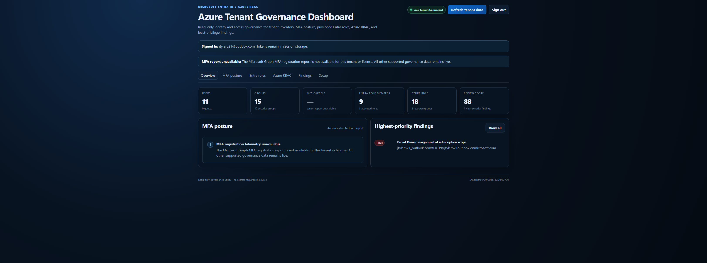
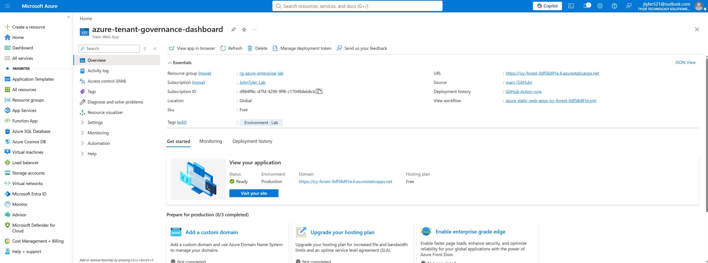

# Azure Tenant Governance Dashboard

A read-only, multi-tenant JavaScript/Vite web application for Microsoft Entra ID and Azure access governance. The dashboard lets authorized users sign in with Microsoft Entra ID, queries Microsoft Graph and Azure Resource Manager with delegated access, and produces an interactive governance snapshot focused on identity posture, MFA, privileged access, Azure RBAC, least privilege, recent activity, and Azure resource topology.

## Live deployment

**Production Azure Static Web App:** https://icy-forest-0df58d91e.6.azurestaticapps.net

The production deployment uses a shared multi-tenant Microsoft Entra application registration. Users from other Microsoft Entra organizations can authenticate with their own organizational accounts, subject to their tenant's consent policies and their own permissions.

The app does **not** grant access to another tenant or Azure subscription by itself. Microsoft Graph data is limited by the signed-in user's delegated permissions and Entra role context, while Azure subscription analysis requires the signed-in user to already have appropriate Azure RBAC access in that subscription.

### Live tenant dashboard



### Azure Static Web App deployment



## What it does

- Inventories Microsoft Entra users, guest users, groups, and service principals.
- Syncs tenant groups with their direct user members in an expandable **Groups & Members** view.
- Reviews MFA-capable, MFA-registered, and passwordless-capable users.
- Enumerates active Microsoft Entra directory roles and their members.
- Provides a **Recent Activity** view for Entra directory audit events and, when licensing and permissions allow, tenant sign-in telemetry.
- Provides a **Privileged Access** view for users with active or eligible Entra privileged roles, including role name, scope, assignment type, and available start/end timestamps.
- Inventories Azure RBAC role assignments and role definitions at subscription and resource scopes.
- Provides a live **Azure Topology** view for subscription resources, including VNet → subnet → NIC → VM relationships with Public IP and NSG context.
- Flags broad Azure assignments such as Owner, Contributor, and User Access Administrator.
- Flags privileged Entra identities that are not reported as MFA-capable.
- Flags guest identities with broad Azure access.
- Produces a lightweight governance review score.
- Exports findings as JSON or CSV.

The application is intentionally **read-only**. It does not perform Microsoft Graph or Azure Resource Manager write operations.

## Multi-tenant model

The production application is designed so users from other Microsoft Entra organizations can authenticate without creating a separate app registration for each tenant.

At a high level:

1. The browser redirects the user to Microsoft Entra ID through MSAL.js.
2. The user authenticates with an organizational Microsoft account.
3. Microsoft Entra evaluates the tenant's consent and access policies.
4. The browser receives delegated access tokens for the approved Microsoft Graph and Azure Resource Manager scopes.
5. The dashboard queries only data the signed-in identity is already authorized to read.

Authentication does **not** equal authorization. Signing in successfully does not automatically provide access to privileged Entra data or an Azure subscription.

## External-tenant onboarding

For a user in another Microsoft Entra organization:

1. Open the production dashboard.
2. Sign in with the organization's Microsoft Entra account.
3. Complete user or administrator consent if required by that tenant's consent policy.
4. Enter the Azure Subscription ID to analyze Azure resources.
5. Ensure the signed-in account already has the required Microsoft Entra permissions and Azure RBAC access described below.

No client secret is required from the user, and users do not need to create their own application registration for the hosted multi-tenant version.

## Architecture

```text
Browser SPA
  |
  |-- MSAL.js / OAuth 2.0 Authorization Code + PKCE
  |      |
  |      +-- Microsoft Entra ID (multi-tenant authentication)
  |
  |-- Microsoft Graph
  |      |-- Users / Groups / Service Principals
  |      |-- Group → direct user membership
  |      |-- Directory Roles
  |      |-- Role Assignment Schedule Instances
  |      |-- Role Eligibility Schedule Instances
  |      |-- Authentication Methods Registration Report
  |      |-- Directory Audit Logs
  |      +-- Sign-in Logs when available
  |
  +-- Azure Resource Manager
         |-- Role Assignments
         |-- Role Definitions
         |-- Resource Groups
         |-- Virtual Networks / Subnets
         |-- Network Interfaces
         |-- Public IPs / NSGs
         +-- Virtual Machines
```

There is no application backend. Access tokens are handled by MSAL in browser session storage. Tenant data remains in browser memory unless the user explicitly exports a findings file.

## Permission model

The dashboard depends on two separate authorization layers.

### 1. Microsoft Entra ID / Microsoft Graph

The shared application requests delegated Microsoft Graph access for the governance data it reads. Depending on the feature and tenant policy, administrator consent and an appropriate Microsoft Entra directory role may be required.

Relevant delegated permissions include:

- `User.Read`
- `Directory.Read.All`
- `RoleManagement.Read.Directory`
- `AuditLog.Read.All`

Examples:

- Authentication Methods reporting depends on `AuditLog.Read.All` plus the signed-in user's effective Entra permissions.
- Sign-in logs depend on Graph permissions, the signed-in user's Entra permissions, and licensing that exposes sign-in telemetry.
- Privileged-role visibility depends on the role-management permissions exposed to the signed-in identity.

### 2. Azure Resource Manager / Azure RBAC

The dashboard also requests Azure Service Management delegated access:

```text
https://management.azure.com/user_impersonation
```

That scope allows the application to act on behalf of the signed-in user. It does **not** grant Azure subscription access by itself.

For Azure subscription analysis, the signed-in user must already have RBAC access to the Subscription ID entered in the dashboard.

Recommended read-only access:

- **Reader** at the subscription scope is the baseline for resource inventory used by the Azure Topology view.
- **Role Based Access Control Reader** at the subscription scope is recommended when the dashboard needs to reliably enumerate Azure role assignments and role definitions.

The dashboard does **not** require Owner, Contributor, or User Access Administrator simply to function. Assigning broad roles only for this dashboard would violate least-privilege principles.

Knowing a Subscription ID does not provide access to that subscription.

## Security boundaries

- The app is read-only by design.
- It does not create, modify, or delete Microsoft Entra identities, groups, roles, policies, or Azure resources.
- It does not bypass tenant Conditional Access, consent requirements, licensing restrictions, Entra directory roles, or Azure RBAC.
- A user can only retrieve data Microsoft Entra ID, Microsoft Graph, and Azure Resource Manager authorize for that identity.
- No client secret is embedded in the browser application.
- The shared Entra application/client ID is a public application identifier, not a credential.
- Access tokens are not committed to GitHub.
- MSAL authentication cache uses `sessionStorage`.
- Only non-secret configuration identifiers are persisted in browser storage.
- Findings exports are generated locally in the browser.
- The governance score is a heuristic and is not a security certification, audit opinion, or compliance attestation.

## Local development

```bash
npm install
npm run dev
```

Open the local Vite URL, normally:

```text
http://localhost:5173
```

Local development may require the appropriate Entra client configuration and redirect URI for the environment being used.

## Production deployment

The project is deployed to Azure Static Web Apps from this GitHub repository through GitHub Actions.

Current deployment model:

1. Source repository: `johninfra/azure-tenant-governance-dashboard`
2. Branch: `main`
3. Frontend build: Vite
4. Output directory: `dist`
5. Authentication: shared multi-tenant Microsoft Entra application registration
6. Hosting: Azure Static Web Apps
7. Deployment: GitHub Actions

The production build injects the public Entra application/client ID used by the multi-tenant SPA. No client secret is required or embedded in the frontend.

## Self-hosting

If you fork or self-host this project instead of using the production deployment, create and configure your own Microsoft Entra application registration.

### Authentication

Configure the application as a **Single-page application (SPA)** and add the appropriate redirect URIs, for example:

```text
http://localhost:5173
```

and your hosted production origin:

```text
https://<your-static-web-app>.azurestaticapps.net
```

If you use a custom domain, add that origin as an SPA redirect URI as well.

For a self-hosted multi-tenant deployment, configure the app registration to support the intended organizational account types and apply the Graph delegated permissions listed above.

**Do not add a client secret to the SPA.**

## Setup inside the dashboard

For the hosted multi-tenant version, the Entra application/client ID is supplied by the deployed build. The user primarily provides the **Azure Subscription ID** for Azure resource analysis.

The setup experience also explains the Azure RBAC requirements so users can distinguish authentication from authorization and avoid assigning unnecessarily broad Azure roles.

## GitHub Actions

The repository includes GitHub Actions automation for Azure Static Web Apps deployment as well as workflow health-check logic used to validate the repository's deployment path.

## Portfolio value

This project demonstrates hands-on work with:

- Microsoft Entra ID
- Multi-tenant Microsoft identity architecture
- OAuth 2.0 Authorization Code Flow with PKCE
- MSAL.js
- Microsoft Graph
- Azure Resource Manager REST APIs
- Azure RBAC
- Microsoft Entra privileged role visibility
- MFA posture review
- identity governance
- audit and sign-in telemetry
- least privilege
- Azure resource topology
- cloud security monitoring
- Azure Static Web Apps
- GitHub Actions / GitHub-to-Azure deployment workflows
- browser-based security boundaries for public-client SPAs

## Important design principle

This dashboard intentionally separates **authentication** from **authorization**:

> A user being able to sign in proves identity. It does not grant access to Microsoft Entra or Azure data the user does not already have permission to read.

That distinction is central to the application's multi-tenant security model.

## Suggested GitHub topics

`azure` `microsoft-entra-id` `iam` `rbac` `mfa` `identity-governance` `multitenant` `msal` `microsoft-graph` `azure-security` `javascript` `azure-static-web-apps`

## License

MIT
